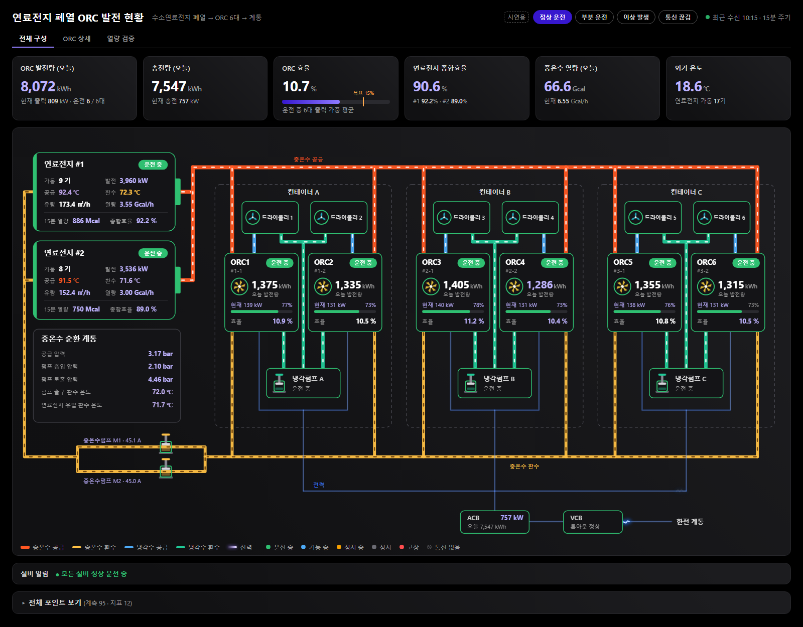
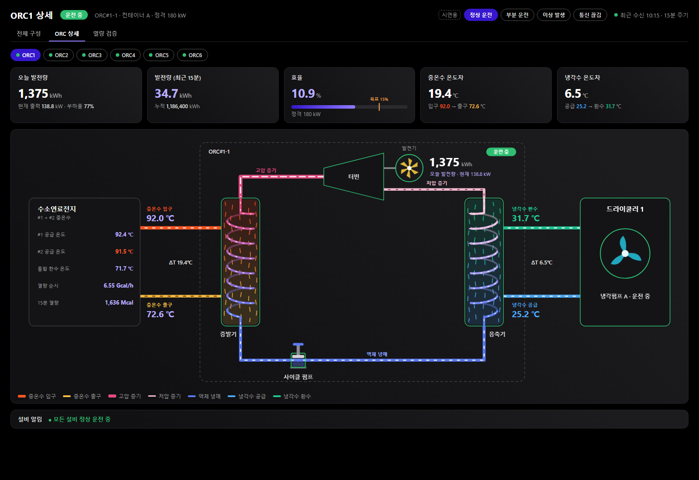
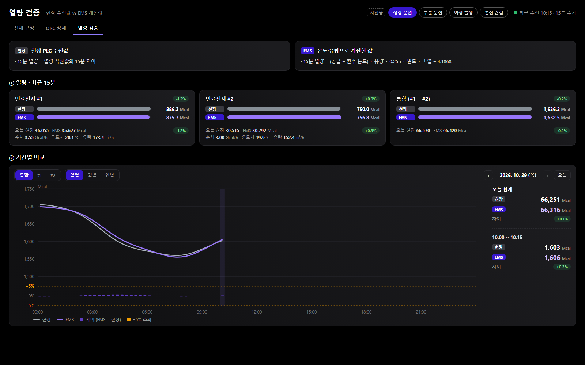

# Fuel Cell Waste-Heat ORC Dashboard

수소연료전지 폐열로 ORC(Organic Rankine Cycle) 발전기 6대를 돌리는 설비의 **실시간 모니터링 화면 샘플**입니다.
EMS(에너지관리시스템) 안에 넣어 쓰는 것을 전제로, 빌드 도구 없이 순수 HTML · SVG · CSS · JavaScript 로 만들었습니다.

> 모든 수치는 시연용 가짜 데이터(`data/mock-scenarios.js`)입니다. 실제 현장·고객 정보는 포함하지 않습니다.

**라이브 데모:** https://bob-joosayo.github.io/fuelcell-orc-dashboard/ — [전체 구성](https://bob-joosayo.github.io/fuelcell-orc-dashboard/overview.html) · [ORC 상세](https://bob-joosayo.github.io/fuelcell-orc-dashboard/orc-detail.html?unit=1) · [열량 검증](https://bob-joosayo.github.io/fuelcell-orc-dashboard/verify.html) · [전력 애니메이션 비교](https://bob-joosayo.github.io/fuelcell-orc-dashboard/elec-samples.html)



## 설비 구성

```
연료전지 #1·#2 폐열 → 중온수 헤더 → 컨테이너 A/B/C (ORC 180 kW × 6 · 드라이쿨러 6 · 냉각펌프 3) → ACB → VCB → 계통
```

## 화면

| 파일 | 내용 |
|---|---|
| `overview.html` | 전체 구성 — 연료전지 → 중온수 순환 → ORC 6대 → 전력 계통. KPI(오늘 발전량·송전량·ORC 효율 등), 설비 알림, 전체 포인트 표 |
| `orc-detail.html?unit=1~6` | ORC 1대 상세 — 증발기 → 터빈·발전기 → 응축기 → 사이클 펌프, 냉각수 ↔ 드라이쿨러 |
| `verify.html` | 열량 검증 — 연료전지 중온수 열량을 현장 계측값과 EMS 계산값(온도·유량 기반)으로 비교, 일·월·연 기간 비교 |
| `elec-samples.html` | 전력선 애니메이션 6가지 비교 페이지 (A안 채택) |

| ORC 상세 | 열량 검증 |
|---|---|
|  |  |

## 실행

빌드가 필요 없습니다. `overview.html` 을 브라우저로 바로 열면 됩니다 (`file://` 에서도 동작).

```bash
# 또는 간단한 로컬 서버
python -m http.server 8000
# http://localhost:8000/overview.html
```

화면 오른쪽 위 시연 버튼으로 시나리오를 바꿀 수 있습니다.

| 시나리오 | 내용 |
|---|---|
| 정상 운전 | 6대 운전, 냉각펌프 3대 운전 |
| 부분 운전 | 1대 정지, 1대 기동 중 |
| 이상 발생 | 냉각펌프 고장 → 해당 컨테이너 ORC 2대 정지 중 |
| 통신 끊김 | 연료전지 1기 미수신 → "통신 없음", 관련 지표 "—" |

## 구조

```
assets/
  orc-viz.js      공통 엔진: 값 조회·상태 판정·SVG 아이콘(팬·피스톤 펌프·프로펠러 발전기·건전지형 연료전지)·배관 흐름·툴팁·KPI·이력 조회
  orc-viz.css     다크 테마. 모든 규칙을 .orc-viz 아래로 한정해 상위 페이지 CSS와 충돌 방지
  overview.js     전체 구성
  orc-detail.js   ORC 상세
  verify.js       열량 검증 (기간별 차트 직접 그림)
data/
  point-map.js       포인트 정의 (계측 95 · 지표 24, 시연용 가상 키 "설비.포인트.호기" 예: orc.output_kw.01)
  mock-scenarios.js  시연용 스냅샷·이력 데이터
```

## 실데이터 연동

화면은 데이터 공급 함수만 바꾸면 그대로 실데이터로 동작합니다.

```js
// 최신값: { 포인트키: { v: 화면 단위 값, ts: epoch ms } }
OrcViz.setProvider(() => fetchLatest());
// 기간 이력: ({ ids, period: "day" | "month" | "year", start }) => { ID: [{ t, v, n }] }
OrcViz.setHistoryProvider((req) => fetchHistory(req));
```

- 실제 EMS 포인트 코드는 `data/point-map.js` 의 키만 바꾸면 연결됩니다. 화면에는 키를 노출하지 않습니다 (툴팁·표 모두 사람이 읽는 이름).
- 모니터링 화면에는 현장 계측값만 보이고, EMS가 계산한 값은 검증 화면에서만 씁니다.

## 애니메이션

- 배관: 점선이 흐름 방향으로 이동, 유량·출력에 따라 속도 변화
- 전력선: 선보다 살짝 큰 미니 지그재그 번개가 지지직거리며 흐름 (출력이 클수록 빠르고 자주)
- 열교환기: 셸 안 나선 코일 대향류, 펌프: 피스톤 프레스, 발전기: 프로펠러 회전
- `prefers-reduced-motion` 설정이면 움직임을 끄고 색만 남김
